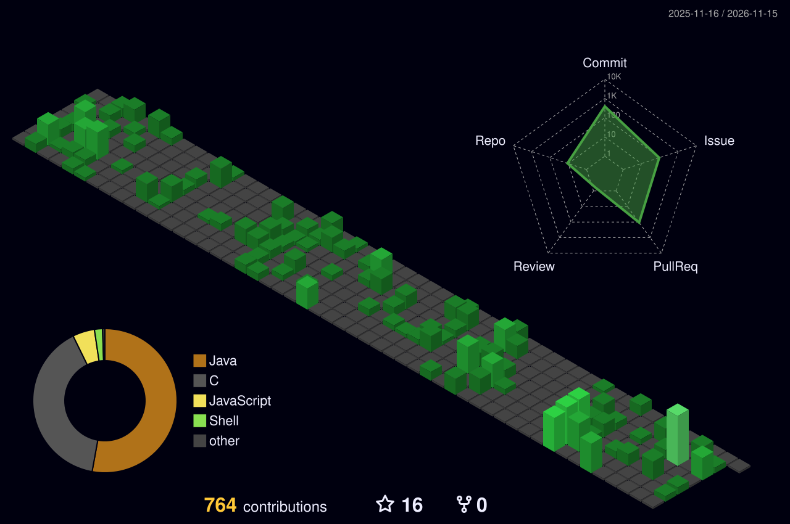

# AFaria20s

*404* ✤ Computer Engineering Student @ UNIPVC

### About

- Computer engineering at UNIPVC, Portugal - software engineering, AI, statistics, systems programming
- OOP, Low-level and Linux enthusiast, terminal-first... always... :v

### Latest projects:

- **[LostOS](https://github.com/AFaria20s/LostOS)** - a bare-metal x86 OS written from scratch in C
- **[TeamSync](https://github.com/AFaria20s/TeamSync-Backend)** - Cycling teams management made with Java + Frontend in React

### Open-source Contributions

- **[uutils/coreutils](https://github.com/uutils/coreutils/)** - Cross-platform reimplementation of the GNU coreutils in `Rust`
  - [PR #16399](https://github.com/uutils/coreutils/pull/16399) - Fix a panic in split --number=r/K/N on 32-bit targets when N exceeds usize::MAX **(merged)**
  - [PR #16435](https://github.com/uutils/coreutils/pull/16435) - Correct the hardware capability mapping for PMULL and accept the full PCLMULQDQ name *(under review)*

### Stats

